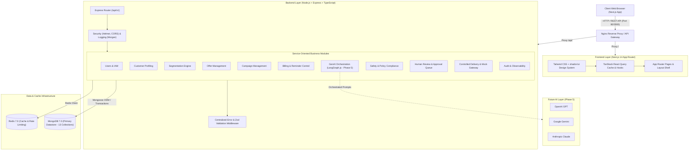

# System Architecture: Customer Loyalty and Engagement Assistant

## 1. Executive Summary & Architecture Overview

The **Customer Loyalty and Engagement Assistant** is an enterprise-grade GenAI-powered customer engagement platform developed for retail and telecom organizations. It categorizes customers using permitted activity, loyalty, active plans, and payment consistency indicators, and prepares grounded, policy-compliant personalized communications.

To ensure long-term maintainability, deterministic compliance, and rapid iterative development, the system is designed as a **Modular Monolith**. The frontend and backend are housed within a unified single repository while strictly maintaining physical and logical decoupling:

---

## 2. Layer Responsibilities & Separation of Concerns

### Frontend Architecture
- **Framework**: Next.js with App Router and React.
- **Language**: TypeScript in strict mode.
- **Styling**: Tailwind CSS configured with enterprise CRM palette (light theme default, subtle greys, blue accents, green success, amber warnings, red error).
- **Design System**: Reusable components modeled on shadcn/ui patterns (`Button`, `Card`, `Badge`, `Input`, `Table`).
- **Icons**: Lucide React.
- **State & Server Sync**: TanStack Query (`@tanstack/react-query`) for automated caching, polling, and background data synchronization.
- **Form Management**: React Hook Form coupled with Zod schema validation.
- **Visual Analytics**: Recharts for future segment distributions and billing trends.

### Backend Architecture
- **Runtime & Framework**: Node.js, Express.js, TypeScript using ES Modules (`"type": "module"`).
- **Architectural Pattern**: Modular Monolith following a clean service-oriented separation:
  - **Routes**: Declare RESTful API paths and HTTP verb bindings.
  - **Controllers**: Handle request unpacking, response status dispatch, and delegation to services.
  - **Services**: Enforce deterministic business rules, eligibility calculations, and orchestration.
  - **Repositories & Models**: Manage Mongoose ODM data access, schemas, validation, and database transactions.
  - **Middlewares**: Enforce Helmet security headers, CORS origin whitelisting, HTTP request logging (Morgan), 404 trapping, and centralized error normalization.
  - **Schemas**: Enforce runtime boundary validation using Zod schemas.
  - **Types**: Maintain TypeScript interfaces for domain entities and API contracts.

### Infrastructure & Operations
- **Containerization**: Multi-stage Dockerfiles for both frontend (Next.js standalone output) and backend.
- **Orchestration**: Docker Compose configuring MongoDB, Redis, Backend, Frontend, and Nginx.
- **Reverse Proxy**: Nginx acting as a unified API gateway and static asset reverse proxy.
- **Primary Database**: MongoDB 7.0 configured with persistent data volume storage and connection pooling.
- **Caching Layer**: Redis 7.0 for session cache, rate-limiting, and high-velocity customer profile caches.

---

## 3. Principles of the Modular Monolithic Approach

1. **Physical Separation, Single Repository**: Frontend and backend are completely decoupled into distinct folders (`frontend/` and `backend/`) with independent `package.json`, TypeScript configs, and build pipelines.
2. **Zero Business Logic in Controllers**: Controllers strictly extract parameters, invoke services, and return typed JSON responses.
3. **Deterministic Business Rules vs. Probabilistic GenAI**:
   - Customer segmentation, billing overdue stage progression, offer eligibility, and safety rules are **100% deterministic code**.
   - GenAI is strictly utilized for creative, personalized, grounded message synthesis bounded by verified facts.
4. **Resilient Failure Modes**: When Redis or secondary services are degraded, core API operations continue with graceful degradation.

---

## 4. Future AI Architecture Integration (Phase 5 Roadmap)

In Phase 5, the `modules/ai` and `modules/compliance` domains will be integrated:
- **LangGraph.js Orchestration**: State graph managing multi-step message synthesis:
  1. *Profile Extraction Node*: Extracts verified customer attributes and active campaign guidelines.
  2. *Deterministic Guardrail Node*: Injects mandatory terms, disclaimers, and blocked language.
  3. *LLM Drafting Node*: Generates draft subject and body via OpenAI, Gemini, or Claude.
  4. *Groundedness Validation Node*: Cross-checks draft against source facts to prevent hallucinated amounts, dates, or terms.
  5. *Approval Dispatch Node*: Queues validated drafts in human reviewer queue before delivery.
