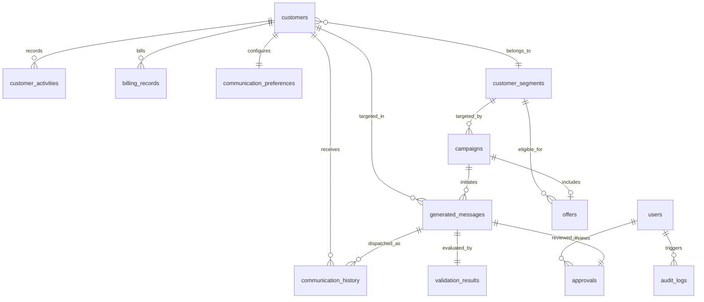

# Database Architecture & Data Contracts: MongoDB Design

## 1. Overview & Strategy

MongoDB serves as the primary datastore for the **Customer Loyalty and Engagement Assistant**. The database architecture balances relational integrity, read scalability, and high-velocity timeline queries through deliberate schema design:

1. **ObjectId Referencing**: Applied for high-cardinality and unbounded relationships (e.g. activities, billing history, communication logs, generated messages, audit trails).
2. **Subdocument Embedding**: Applied strictly to small, bounded, logically atomic child data whose lifecycle is completely coupled to the parent (e.g. customer plan details, segment rule conditions, message grounding facts).
3. **No Unbounded Arrays**: To eliminate document bloating and MongoDB's 16MB document limit, historical events are never embedded as growing arrays in customer records.
4. **Audit Immutability**: Audit logs and activities use append-only write patterns.
5. **ACID Transactions**: Multi-document MongoDB sessions and transactions are planned for atomic state changes (such as approving a message and recording an approval audit log).

---

## 2. Entity Relationship Diagram (ERD)

---

## 3. Comprehensive Collection Specifications

### 3.1. `users`
- **Purpose**: System operators, reviewers, compliance officers, and administrators who log in to review messages, adjust campaign guidelines, and inspect audit logs.
- **Embedded vs. Referenced**: Independent root collection.
- **Key Fields**:
  - `_id`: `ObjectId` (Primary Key, Required)
  - `email`: `String` (Required, Unique, Lowercase, Indexed)
  - `name`: `String` (Required)
  - `passwordHash`: `String` (Protected, omitted from default projections)
  - `role`: `String` (Enum: `admin`, `reviewer`, `agent`, `compliance_officer`, Required)
  - `status`: `String` (Enum: `active`, `inactive`, `suspended`, Required)
  - `department`: `String` (Optional)
  - `lastLoginAt`: `Date` (Optional)
  - `createdAt`: `Date`, `updatedAt`: `Date`
- **Suggested Indexes**:
  - `{ email: 1 }` (Unique)
  - `{ role: 1, status: 1 }`

---

### 3.2. `customers`
- **Purpose**: Unified customer profile aggregating retail/telecom identity, loyalty tier, tenure, plan details, and segment association.
- **Embedded vs. Referenced**: References `customer_segments` via `assignedSegmentId`. Embeds bounded `planDetails`. Does **not** embed activities or billing records.
- **Key Fields**:
  - `_id`: `ObjectId` (Primary Key, Required)
  - `customerId`: `String` (Business Key, e.g. `CUST-10492`, Required, Unique, Indexed)
  - `firstName`: `String`, `lastName`: `String` (Required)
  - `email`: `String` (Required, Indexed)
  - `phone`: `String` (Optional)
  - `industry`: `String` (Enum: `retail`, `telecom`, Required)
  - `status`: `String` (Enum: `active`, `dormant`, `at_risk`, `churned`, Required)
  - `loyaltyTier`: `String` (Enum: `standard`, `silver`, `gold`, `platinum`, Required)
  - `loyaltyPoints`: `Number` (Default 0)
  - `tenureMonths`: `Number` (Default 0)
  - `planDetails`: `Subdocument` (`planName`, `monthlyFee`, `currency`, `startDate`, `contractTermMonths`)
  - `assignedSegmentId`: `ObjectId` (Ref: `customer_segments`, Indexed)
  - `createdAt`: `Date`, `updatedAt`: `Date`
- **Suggested Indexes**:
  - `{ customerId: 1 }` (Unique)
  - `{ email: 1, industry: 1 }`
  - `{ status: 1, loyaltyTier: 1 }`
  - `{ assignedSegmentId: 1 }`

---

### 3.3. `customer_activities`
- **Purpose**: Fine-grained customer interaction events (purchases, support tickets, plan modifications, app logins). Essential for calculating activity decline or dormancy.
- **Embedded vs. Referenced**: Referenced by `customerRef` to allow unbounded growth without inflating customer documents.
- **Key Fields**:
  - `_id`: `ObjectId` (Primary Key, Required)
  - `customerRef`: `ObjectId` (Ref: `customers`, Required, Indexed)
  - `customerId`: `String` (Required, Denormalized business key)
  - `activityType`: `String` (Enum: `purchase`, `support_ticket`, `plan_change`, `usage_surge`, `portal_login`, `inquiry`, Required)
  - `channel`: `String` (Enum: `web`, `mobile_app`, `store`, `call_center`, `system`, Required)
  - `title`: `String` (Required), `description`: `String` (Optional)
  - `metadata`: `Mixed` (Payload specific to event type)
  - `occurredAt`: `Date` (Required, Indexed)
  - `createdAt`: `Date`
- **Suggested Indexes**:
  - `{ customerRef: 1, occurredAt: -1 }` (Compound for fast customer timeline lookup)
  - `{ activityType: 1, occurredAt: -1 }`

---

### 3.4. `billing_records`
- **Purpose**: Invoices, payment records, overdue status tracking, and reminder stage progression (FR-06).
- **Embedded vs. Referenced**: Referenced by `customerRef`.
- **Key Fields**:
  - `_id`: `ObjectId` (Primary Key, Required)
  - `customerRef`: `ObjectId` (Ref: `customers`, Required, Indexed)
  - `customerId`: `String` (Required)
  - `invoiceNumber`: `String` (Unique, Required)
  - `billingDate`: `Date` (Required), `dueDate`: `Date` (Required, Indexed)
  - `amountDue`: `Number` (Required), `amountPaid`: `Number` (Default 0)
  - `currency`: `String` (Default `USD`)
  - `status`: `String` (Enum: `paid`, `pending`, `overdue`, `disputed`, `cancelled`, Required)
  - `daysOverdue`: `Number` (Default 0)
  - `reminderStage`: `String` (Enum: `none`, `first_courteous`, `second_reminder`, `final_overdue`, Required)
  - `paidAt`: `Date` (Optional)
  - `createdAt`: `Date`, `updatedAt`: `Date`
- **Suggested Indexes**:
  - `{ invoiceNumber: 1 }` (Unique)
  - `{ customerRef: 1, status: 1 }`
  - `{ status: 1, dueDate: 1 }`

---

### 3.5. `communication_preferences`
- **Purpose**: Compliance consent controls, channel preferences, frequency capping, and do-not-disturb (FR-07).
- **Embedded vs. Referenced**: 1-to-1 referenced collection per customer.
- **Key Fields**:
  - `_id`: `ObjectId` (Primary Key, Required)
  - `customerRef`: `ObjectId` (Ref: `customers`, Unique, Required)
  - `customerId`: `String` (Unique, Required)
  - `emailOptIn`: `Boolean` (Default true)
  - `smsOptIn`: `Boolean` (Default false)
  - `preferredChannel`: `String` (Enum: `email`, `sms`, `portal`, Default `email`)
  - `frequencyCapPerWeek`: `Number` (Default 3)
  - `doNotDisturb`: `Boolean` (Default false, Indexed)
  - `blacklistedTopics`: `[String]` (Default empty)
  - `lastConsentDate`: `Date` (Default now)
  - `consentSource`: `String` (Default `account_onboarding`)
  - `createdAt`: `Date`, `updatedAt`: `Date`
- **Suggested Indexes**:
  - `{ customerRef: 1 }` (Unique)
  - `{ customerId: 1 }` (Unique)

---

### 3.6. `communication_history`
- **Purpose**: Immutable history of sent or mock-delivered messages, delivery statuses, bounce events, or safety blocks (FR-10).
- **Embedded vs. Referenced**: Referenced by `customerRef`.
- **Key Fields**:
  - `_id`: `ObjectId` (Primary Key, Required)
  - `customerRef`: `ObjectId` (Ref: `customers`, Required, Indexed)
  - `customerId`: `String` (Required)
  - `generatedMessageRef`: `ObjectId` (Ref: `generated_messages`, Optional)
  - `campaignRef`: `ObjectId` (Ref: `campaigns`, Optional)
  - `channel`: `String` (Default `email`)
  - `recipient`: `String` (Required)
  - `subject`: `String` (Required)
  - `deliveryStatus`: `String` (Enum: `mock_delivered`, `sent`, `delivered`, `bounced`, `blocked`, `failed`, Required)
  - `blockReason`: `String` (Optional)
  - `providerMessageId`: `String` (Optional)
  - `dispatchMetadata`: `Mixed` (Optional)
  - `sentAt`: `Date` (Default now, Indexed)
- **Suggested Indexes**:
  - `{ customerRef: 1, sentAt: -1 }`
  - `{ deliveryStatus: 1, sentAt: -1 }`

---

### 3.7. `customer_segments`
- **Purpose**: Interpretable behavioral segment definitions with deterministic rules, strategy mappings, and tone policies (FR-02, FR-03).
- **Embedded vs. Referenced**: Root referenced entity. Embeds rule conditions array.
- **Key Fields**:
  - `_id`: `ObjectId` (Primary Key, Required)
  - `segmentKey`: `String` (Unique, e.g. `consistent_customer`, `loyalty_candidate`, `declining_activity`, `dormant_customer`, `payment_reminder`)
  - `name`: `String` (Required), `description`: `String` (Required)
  - `strategy`: `String` (Enum: `appreciation`, `reward`, `re_engagement`, `courteous_reminder`, `firmer_overdue`)
  - `recommendedTone`: `String` (Enum: `warm_appreciative`, `value_driven`, `gentle_courteous`, `firm_professional`, `urgent_direct`)
  - `rules`: `[ISegmentRuleCondition]` (`field`, `operator`, `value`)
  - `isActive`: `Boolean` (Default true)
  - `priority`: `Number` (Order of rule evaluation)
  - `createdAt`: `Date`, `updatedAt`: `Date`
- **Suggested Indexes**:
  - `{ segmentKey: 1 }` (Unique)
  - `{ isActive: 1, priority: 1 }`

---

### 3.8. `offers`
- **Purpose**: Approved rewards and offers catalog with eligibility criteria, expiration, and terms (FR-05).
- **Embedded vs. Referenced**: Root referenced collection.
- **Key Fields**:
  - `_id`: `ObjectId` (Primary Key, Required)
  - `offerCode`: `String` (Unique, e.g. `REW-LOYAL-50`, Required)
  - `title`: `String`, `description`: `String` (Required)
  - `offerType`: `String` (Enum: `discount`, `bonus_points`, `data_booster`, `plan_upgrade`, `gift_voucher`, `fee_waiver`)
  - `value`: `Number` (Required), `currency`: `String` (Default `USD`)
  - `termsAndConditions`: `String` (Required)
  - `eligibleSegments`: `[ObjectId]` (Refs: `customer_segments`)
  - `eligibleLoyaltyTiers`: `[String]`
  - `minTenureMonths`: `Number` (Default 0)
  - `validFrom`: `Date` (Required), `validUntil`: `Date` (Required, Indexed)
  - `isActive`: `Boolean` (Default true, Indexed)
  - `maxRedemptionsPerCustomer`: `Number` (Default 1)
- **Suggested Indexes**:
  - `{ offerCode: 1 }` (Unique)
  - `{ isActive: 1, validUntil: 1 }`

---

### 3.9. `campaigns`
- **Purpose**: Policy-controlled communication campaigns mapping target segments to strategies, tone guidelines, and offers.
- **Key Fields**:
  - `_id`: `ObjectId` (Primary Key, Required)
  - `campaignCode`: `String` (Unique, Required)
  - `name`: `String`, `description`: `String` (Required)
  - `targetSegmentRef`: `ObjectId` (Ref: `customer_segments`, Required)
  - `associatedOfferRef`: `ObjectId` (Ref: `offers`, Optional)
  - `status`: `String` (Enum: `draft`, `active`, `paused`, `completed`, `archived`)
  - `startDate`: `Date`, `endDate`: `Date` (Required)
  - `toneGuideline`: `String` (Required)
  - `mandatoryDisclaimers`: `[String]`
  - `blockedKeywords`: `[String]`
- **Suggested Indexes**:
  - `{ campaignCode: 1 }` (Unique)
  - `{ status: 1, startDate: 1, endDate: 1 }`

---

### 3.10. `generated_messages`
- **Purpose**: Grounded AI-drafted messages linked to source customer facts, prompt versions, and model metadata (FR-04).
- **Key Fields**:
  - `_id`: `ObjectId` (Primary Key, Required)
  - `customerRef`: `ObjectId` (Ref: `customers`, Required, Indexed)
  - `campaignRef`: `ObjectId` (Ref: `campaigns`, Optional)
  - `segmentRef`: `ObjectId` (Ref: `customer_segments`, Optional)
  - `subject`: `String`, `body`: `String` (Required)
  - `llmProvider`: `String`, `modelIdentifier`: `String`, `templateVersion`: `String`
  - `groundingFacts`: `[IGroundingFact]` (Embedded fact assertions used to construct message)
  - `status`: `String` (Enum: `draft`, `validated`, `pending_approval`, `approved`, `rejected`, `dispatched`)
  - `toneApplied`: `String`
- **Suggested Indexes**:
  - `{ customerRef: 1, status: 1 }`
  - `{ campaignRef: 1, status: 1 }`

---

### 3.11. `validation_results`
- **Purpose**: Deterministic safety and compliance check records verifying groundedness, consent, sensitive data leakage, and blocked language (FR-07).
- **Key Fields**:
  - `_id`: `ObjectId` (Primary Key, Required)
  - `generatedMessageRef`: `ObjectId` (Ref: `generated_messages`, Required, Indexed)
  - `customerRef`: `ObjectId` (Ref: `customers`, Required)
  - `passedAllChecks`: `Boolean` (Required, Indexed)
  - `safetyScore`: `Number` (0.0 to 1.0)
  - `checks`: `[IValidationCheckItem]` (Array of check evaluations)
  - `criticalViolationsCount`: `Number` (Default 0)
  - `inventedFactsDetected`: `Boolean`, `prohibitedLanguageDetected`: `Boolean`, `consentVerified`: `Boolean`
  - `evaluatedAt`: `Date` (Default now)
- **Suggested Indexes**:
  - `{ generatedMessageRef: 1 }`
  - `{ passedAllChecks: 1, evaluatedAt: -1 }`

---

### 3.12. `approvals`
- **Purpose**: Human-in-the-loop reviewer queue capturing reviewer actions, edits, approval or refusal, and feedback notes (FR-08).
- **Key Fields**:
  - `_id`: `ObjectId` (Primary Key, Required)
  - `generatedMessageRef`: `ObjectId` (Ref: `generated_messages`, Unique, Required)
  - `customerRef`: `ObjectId` (Ref: `customers`, Required)
  - `reviewerRef`: `ObjectId` (Ref: `users`, Optional)
  - `status`: `String` (Enum: `pending`, `approved`, `rejected`, `edited_and_approved`, Required)
  - `originalSubject`: `String`, `originalBody`: `String` (Required)
  - `editedSubject`: `String`, `editedBody`: `String` (Optional)
  - `reviewerNotes`: `String`, `rejectionReasonCode`: `String` (Optional)
  - `reviewedAt`: `Date`
- **Suggested Indexes**:
  - `{ generatedMessageRef: 1 }` (Unique)
  - `{ status: 1, createdAt: 1 }` (For reviewer queue polling)

---

### 3.13. `audit_logs`
- **Purpose**: Immutable tamper-evident audit trail capturing prompt versions, model identifiers, policy decisions, reviewer edits, and dispatch actions (FR-09).
- **Key Fields**:
  - `_id`: `ObjectId` (Primary Key, Required)
  - `actorType`: `String` (Enum: `user`, `system`, `ai_agent`, Required)
  - `actorId`: `String` (Required)
  - `action`: `String` (Enum: `CUSTOMER_PROFILE_ASSEMBLED`, `SEGMENT_CLASSIFIED`, `OFFER_RECOMMENDED`, `MESSAGE_DRAFTED`, `COMPLIANCE_EVALUATED`, `HUMAN_APPROVAL_SUBMITTED`, `MESSAGE_DISPATCHED`, `POLICY_VIOLATION_BLOCKED`, Required)
  - `entityType`: `String` (Required), `entityId`: `String` (Required)
  - `metadata`: `Mixed` (Sanitized structured payload, strictly excluding sensitive raw PII)
  - `ipAddress`: `String` (Optional)
  - `timestamp`: `Date` (Default now, Indexed)
- **Suggested Indexes**:
  - `{ entityType: 1, entityId: 1 }`
  - `{ timestamp: -1 }`
  - `{ action: 1, timestamp: -1 }`

---

## 4. Multi-Document Transaction Plan

For subsequent development phases, MongoDB ACID replica set transactions will be employed for critical multi-document operations:
1. **Approval Dispatch**: Atomically updating `approvals` status, updating `generated_messages` status to `approved`, and writing to `audit_logs`.
2. **Controlled Delivery**: Verifying approval record status, writing to `communication_history`, incrementing customer contact frequency, and logging the dispatch in `audit_logs`.
